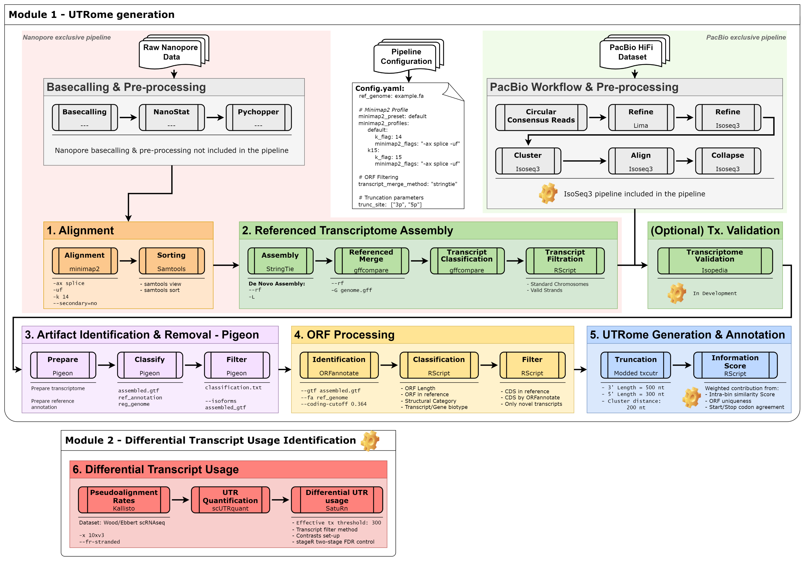

# ENDome generation

[](https://snakemake.github.io)
[](https://pixi.sh)
[](LICENSE)

This repository contains a Snakemake pipeline to generate 3′ or 5′ end-tagged transcriptomes, which we call **ENDomes**, from long-read RNA-seq data. The ENDomes are then employed to quantify transcript-end (UTR) usage in end-tagged single-cell and single-nucleus RNA-seq data (e.g. 10x Genomics 3′ or 5′), and to test for differential UTR usage between conditions or cell types.


The pipeline is a generalization of the approach used to build a brain-specific 3′ UTRome from Oxford Nanopore long-read data, which was then used to detect differential 3′ UTR usage (e.g. in *APP* and *SNCA*) in:

> Fairbrother-Browne Á., Grant-Peters M., Brenton J.W. *et al.* Molecular and cellular signatures differentiate Parkinson's disease from Parkinson's disease with dementia. *bioRxiv* 2025.03.04.641379 (2025). https://doi.org/10.1101/2025.03.04.641379

Both the truncation strategy and the UTR quantification are based on the work of Mervin M. Fansler, who developed [txcutr](https://github.com/mfansler/txcutr) and [scUTRquant](https://github.com/Mayrlab/scUTRquant). `txcutr` is a Bioconductor package that truncates a transcriptome to the sequenced end of each transcript and merges the transcripts that become indistinguishable. `scUTRquant` is a pipeline that quantifies 3′ UTR isoforms from scRNA-seq data against this type of truncated transcriptome. Both are described in:

> Fansler M.M., Mitschka S. & Mayr C. Quantifying 3′UTR length from scRNA-seq data reveals changes independent of gene expression. *Nature Communications* 15:4050 (2024). https://doi.org/10.1038/s41467-024-48254-9

The full documentation is in the **[ENDome wiki](https://github.com/guillermo1996/Endome_generation/wiki)**. Pipeline is in active development. 

## Overview

End-tagged scRNA-seq libraries (e.g. 10x Genomics 3′ or 5′) only sequence a few hundred bases at one end of each transcript. For this reason, tools such as [scUTRquant](https://github.com/Mayrlab/scUTRquant) quantify the reads against a *truncated* transcriptome, where every transcript is cut down to a fixed window at the sequenced end. Transcripts whose windows cannot be distinguished are merged into a single quantification unit, which we call a **bin**.

The pipeline is divided in two modules:

- **Module 1 - ENDome generation (steps 01 to 05)**: builds the truncated transcriptome from long-read RNA-seq data.
- **Module 2 - Differential UTR usage (step 06, in development)**: quantifies the bins of each ENDome in single-cell or single-nucleus data, and tests for differential usage between conditions within each cell type.



| Step | What it does |
|---|---|
| [01 - Alignment](https://github.com/guillermo1996/Endome_generation/wiki/2.1-Alignment) | Aligns the long reads to the genome (minimap2). |
| [02 - Transcriptome assembly](https://github.com/guillermo1996/Endome_generation/wiki/2.2-Transcriptome-assembly) | Assembles each sample and merges the samples of a group (StringTie or isomatch). |
| [03 - Artifact removal](https://github.com/guillermo1996/Endome_generation/wiki/2.3-Artifact-removal) | Classifies the transcripts and removes likely artifacts (pigeon). |
| [04 - ORF identification](https://github.com/guillermo1996/Endome_generation/wiki/2.4-ORF-identification) | Predicts ORFs and selects the transcripts that enter the ENDome (ORFannotate). |
| [05 - Truncation](https://github.com/guillermo1996/Endome_generation/wiki/2.5-Truncation) | Truncates the transcripts, defines the bins and scores them (txendcutr, MMseqs2). |
| [06 - UTR quantification](https://github.com/guillermo1996/Endome_generation/wiki/2.6-UTR-quantification) | Quantifies the bins in the single-cell dataset (scUTRquant). |
| [07 - UTR usage](https://github.com/guillermo1996/Endome_generation/wiki/2.7-UTR-usage) | Pseudobulks the nuclei and tests for differential bin usage (satuRn). |

## Quick start

### 1. Installation

The pipeline runs on Linux (x86_64) and needs [pixi](https://pixi.sh).

```bash
git clone https://github.com/guillermo1996/Endome_generation.git
cd Endome_generation
pixi install
pixi shell
```

See [Installation](https://github.com/guillermo1996/Endome_generation/wiki/1.1-Installation).

### 2. Configure

The run is set in [`config/config.yaml`](config/config.yaml), and the settings of each tool in [`config/presets.yaml`](config/presets.yaml).

1. Set the reference genome and annotation (`ref_genome`, `ref_annotation`).
2. List the long-read samples in the sample sheet (`input_endome_samples`, default `data/endome_input_samples.tsv`): one row per sample, with the columns `dataset`, `group`, `sample_id`, `file_type` (`fastq` or `bam`) and `path`.
3. Describe the single-cell dataset in `sc_dataset` (scUTRquant sample sheet, cell annotations and the contrasts to test).
4. List the ENDomes to build in `pipeline_runs`. Each run builds every combination of its values. Default values across every run can be set in `pipeline_defaults`:

```yaml
pipeline_runs:
  # From long reads: the "control" samples of "Wood" in the sample sheet (4 ENDomes)
  - dataset: "Wood"
    group: "control"
    orf_filter_preset: ["ref_pc", "pc_novel"]
    trunc_site: "5p"
    trunc_width: [300, 500]

  # From a transcriptome assembled elsewhere to skips the assembly
  - dataset: "my_assembly"
    pre-assembled_gtf: "data/custom_inputs/my_assembly.gtf"
    trunc_site: "3p"
    trunc_width: 500
```

See [Inputs](https://github.com/guillermo1996/Endome_generation/wiki/1.2-Inputs) and [Configuration](https://github.com/guillermo1996/Endome_generation/wiki/1.3-Configuration).

### 3. Run

```bash
snakemake -n   # dry run: list the jobs without running anything
snakemake      # run the pipeline
```

See [Running the pipeline](https://github.com/guillermo1996/Endome_generation/wiki/1.4-Running-the-pipeline) for the other targets (ENDome database, reports) and the execution profiles.

## Repository structure

```text
├── config/
│   ├── config.yaml              what to run, paths and selected presets
│   ├── presets.yaml             settings of every tool
│   └── scUTRquant_config.yaml   template of the scUTRquant configuration (step 06)
├── data/                        sample sheets and inputs
├── schema/                      config schema and ENDome database schema (DBML)
├── tools/                       tool releases downloaded on the first run
├── workflow/
│   ├── Snakefile                entry point
│   ├── rules/                   one rule file per step (00-Common to 07-UTR_Usage, Reports)
│   ├── scripts/                 step scripts
│   ├── reports/                 R Markdown reports
│   ├── lib/                     shared R helpers
│   ├── envs/                    conda environments, one per tool
│   └── profiles/                execution profiles (default, slurm, wb)
└── pixi.toml                    Snakemake and conda environment
```

## Background

The pipeline generalizes the brain-specific 3′ UTRome built from Oxford Nanopore data in Fairbrother-Browne *et al.* (bioRxiv 2025, https://doi.org/10.1101/2025.03.04.641379). The truncation and the quantification build on [txcutr](https://github.com/mfansler/txcutr) and [scUTRquant](https://github.com/Mayrlab/scUTRquant) by Mervin M. Fansler (Fansler *et al.*, Nature Communications 2024, https://doi.org/10.1038/s41467-024-48254-9). The 5′ truncation uses [txendcutr](https://github.com/guillermo1996/txendcutr), a fork of [txcutr](https://github.com/mfansler/txcutr).

## License

MIT. See [LICENSE](LICENSE).

## Contact

Please open an [issue](https://github.com/guillermo1996/Endome_generation/issues), or contact Guillermo Rocamora Pérez (guillermorocamora@gmail.com).